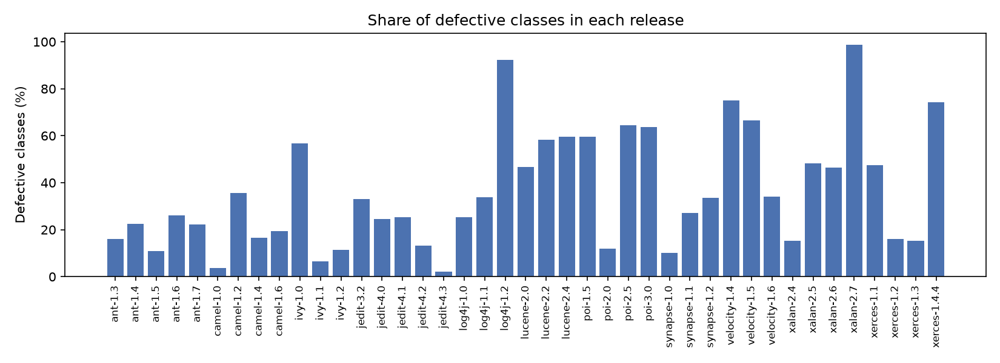
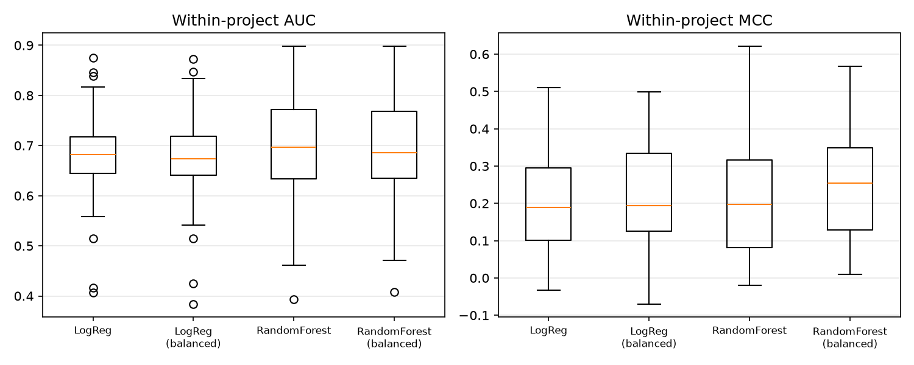
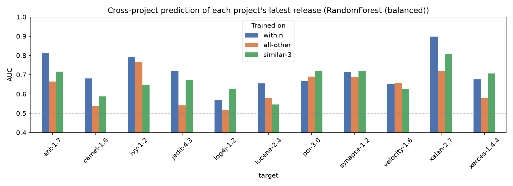

# Software Defect Prediction on the PROMISE Dataset

Can we predict which classes of a Java project will have bugs, using only code metrics? And what can a new project do when it has no bug history of its own?

This project trains simple machine learning models on 41 releases of 11 open-source Java projects and compares two settings:

1. **Within-project:** train on a project's previous release, predict its next release.
2. **Cross-project:** predict a project's latest release using data from *other* projects, either all of them or only the 3 most similar ones.

## Data

The [PROMISE defect datasets](https://github.com/feiwww/PROMISE-backup) (Jureczko and Madeyski, 2010). Each row is one Java class with 20 static code metrics (CK metrics such as `wmc`, `cbo`, `rfc`, `lcom`, plus `loc`, `max_cc` and others). The `bug` column counts bugs found in that class after release. A class is labeled **defective** if `bug > 0`.

| Projects | Releases | Classes | Defective classes |
|---|---|---|---|
| ant, camel, ivy, jedit, log4j, lucene, poi, synapse, velocity, xalan, xerces | 41 | 15,775 | 36% on average, from 2% to 99% per release |



## Method

- **Models:** Logistic Regression (on log-transformed, standardized metrics) and Random Forest (300 trees). Each is also trained with `class_weight="balanced"`, which gives more weight to the rare defective classes.
- **Metrics:** AUC (ranking quality, 0.5 = random), Recall (share of real defects found), F1, and MCC (fair when classes are imbalanced, 0 = random).
- **Within-project:** 30 pairs of consecutive releases (e.g. ant 1.6 → ant 1.7).
- **Cross-project:** for each project's latest release, three training sets:
  - `within`: the project's own previous release (reference point)
  - `all-other`: latest release of all 10 other projects, pooled
  - `similar-3`: only the 3 other projects whose metric distributions (median and spread of each log metric) are closest to the target. Bug labels of the target are never used to choose them.

## Results

### Within-project (mean over 30 release pairs)

| Model | AUC | Recall | F1 | MCC |
|:--|--:|--:|--:|--:|
| LogReg | 0.68 | 0.42 | 0.38 | 0.21 |
| LogReg (balanced) | 0.68 | 0.59 | 0.47 | 0.22 |
| RandomForest | 0.69 | 0.44 | 0.40 | 0.22 |
| RandomForest (balanced) | 0.69 | 0.53 | 0.46 | 0.25 |



### Cross-project (mean over 11 target releases)

| Trained on | Model | AUC | Recall | F1 | MCC |
|:--|:--|--:|--:|--:|--:|
| within | LogReg (balanced) | 0.70 | 0.55 | 0.51 | 0.22 |
| within | RandomForest (balanced) | 0.71 | 0.50 | 0.49 | 0.24 |
| all-other | LogReg (balanced) | 0.67 | 0.55 | 0.49 | 0.18 |
| all-other | RandomForest (balanced) | 0.63 | 0.51 | 0.44 | 0.14 |
| similar-3 | LogReg (balanced) | 0.69 | 0.60 | 0.49 | 0.18 |
| similar-3 | RandomForest (balanced) | 0.67 | 0.44 | 0.40 | 0.15 |

Full tables, including the unbalanced models, are in `results/`.



## Findings

1. **Code metrics carry a real but limited signal.** Within-project AUC is about 0.69, clearly better than random (0.5) but far from perfect.
2. **Class weighting mainly raises recall.** Balanced Logistic Regression finds 59% of defective classes instead of 42%, with similar AUC. Useful when missing a bug costs more than a false alarm.
3. **Pooling all other projects hurts, especially for Random Forest** (AUC drops from 0.71 to 0.63). Projects differ a lot in size and defect rate, and the forest seems to learn patterns that do not transfer.
4. **Choosing similar projects recovers most of the loss.** With only 3 similar projects, AUC goes back to 0.67 to 0.69, close to having the project's own history. Logistic Regression transfers better than Random Forest in this setting.
5. **Results vary a lot by project.** xalan-2.7 is easy (AUC 0.90 within-project), log4j-1.2 is hard. Both are unusual releases where more than 90% of classes are defective.

## Limitations

- Only 11 target releases in the cross-project experiment, one run, and no statistical significance tests.
- The similarity measure is simple (distance between metric profiles). Better ways to pick or weight source projects exist in the literature.
- Default model settings, no tuning.
- Class-level static metrics only. No change history, developer data or code text.

## Ideas for next steps

- Add statistical tests (Wilcoxon, Scott-Knott) and repeat with several random seeds.
- Try other ways to adapt source data to the target (e.g. instance weighting, TCA).
- Effort-aware evaluation: how many bugs are found when inspecting the first 20% of code lines.
- Use code text or embeddings from pre-trained code models instead of hand-made metrics.

## How to run

```bash
pip install -r requirements.txt
cd src
python within_project.py   # experiment 1, writes results/within_project.csv
python cross_project.py    # experiment 2, writes results/cross_project.csv
python plots.py            # figures in results/figures/
```

Runs in about one minute on a laptop.

## Project structure

```
data/                 PROMISE CSV files, one folder per project
src/data.py           loading the releases and features
src/models.py         the four models and the evaluation metrics
src/within_project.py experiment 1
src/cross_project.py  experiment 2
src/plots.py          figures
results/              result tables (CSV) and figures
```

## Reference

M. Jureczko and L. Madeyski, "Towards identifying software project clusters with regard to defect prediction," PROMISE 2010.
